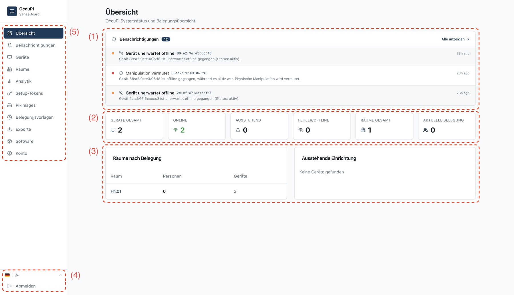
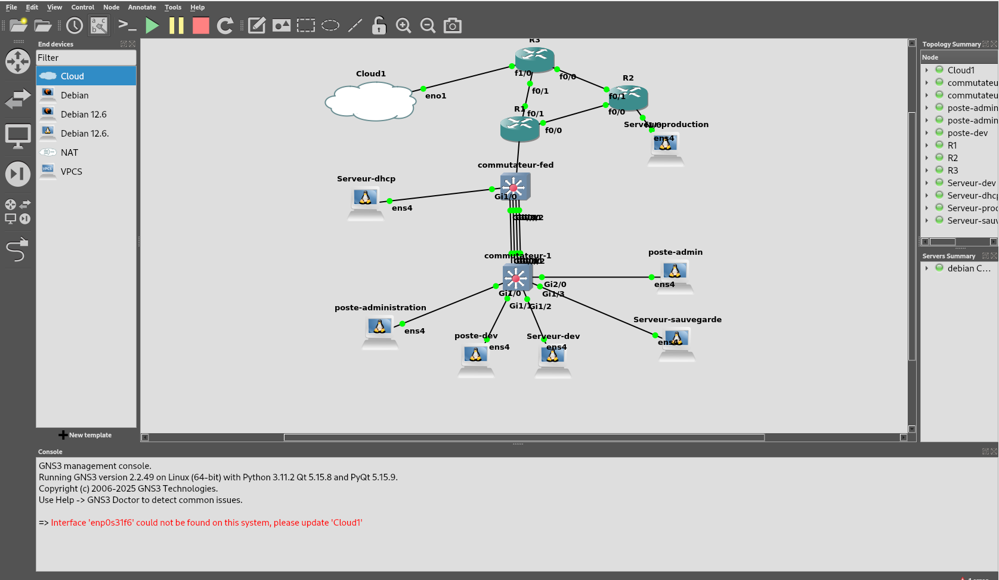

<div align="center">

# Portfolio · Matthieu Dejoie

**Étudiant en BUT Réseaux & Télécommunications à l’IUT de Colmar**  
Développement · Réseaux & systèmes · Cybersécurité · IoT

[Explorer les projets](#-projets) · [Découvrir le site](#-le-site) · [Installation](#-lancer-le-site-en-local) · [Contact](#-contact)

</div>

---

## 👋 Présentation

Bienvenue sur le dépôt de mon **portfolio personnel**. Initialement créé dans le cadre de mon BUT Réseaux & Télécommunications, ce site rassemble une sélection de projets académiques et techniques.

Mon objectif : présenter de façon accessible les problèmes rencontrés, les solutions mises en œuvre et les compétences développées en **programmation, administration des réseaux, cybersécurité et systèmes connectés**.

Le portfolio est un **site statique**, écrit en HTML, CSS et JavaScript, sans framework ni étape de compilation.

## 🖥️ Le site

| Page | Contenu |
| --- | --- |
| [Accueil](index.html) | Présentation rapide, compétences et projets mis en avant |
| [À propos](pages/about.html) | Parcours, formation et expériences |
| [Projets](pages/projects.html) | Catalogue de 7 projets, avec recherche et filtres |
| [Contact](pages/contact.html) | Coordonnées et liens professionnels |

**Fonctionnalités :** interface responsive, navigation mobile, filtres par catégorie et année, recherche de projets, galeries d’images et animations discrètes.

> **Note :** le formulaire de contact est une démonstration côté navigateur : il ne transmet pas de messages à un serveur. Pour me contacter, privilégiez les coordonnées de la page [Contact](pages/contact.html).

## 🚀 Projets

Voici les **7 projets actuellement présentés** sur le site. Chaque fiche détaille le contexte, les outils et les réalisations.

| Projet | Domaine | Description |
| --- | --- | --- |
| **[OccuPI v2](pages/projets/occupi-v2.html)** | IoT · Réseau · Vision par ordinateur | Mesure de l’occupation de salles avec Raspberry Pi, traitement local, MQTT et tableau de bord. |
| **[Gestionnaire de trafic aérien](pages/projets/gestion-trafic-aerien.html)** | Développement web | Application Django de gestion des aéroports, pistes, compagnies, avions et vols. |
| **[Réseau complet GNS3](pages/projets/reseau-gns3.html)** | Réseaux · Systèmes | Conception d’un réseau avec VLAN, routage, DHCP, services Linux et filtrage. |
| **[Outil de traitement de données](pages/projets/outil-traitement-donnees.html)** | Python · Interfaces graphiques | Application PyQt5 d’analyse, de visualisation et de gestion de fichiers volumineux. |
| **[Hygiène informatique](pages/projets/hygiene-informatique.html)** | Cybersécurité | Étude et mise en œuvre de bonnes pratiques de sécurité des postes. |
| **[Dispositif de transmission](pages/projets/dispositif-transmission.html)** | Réseaux · Wi-Fi | Analyse et optimisation de la couverture et de l’infrastructure réseau d’un bâtiment. |
| **[Site web Curriculum Vitae](pages/projets/site-web-cv.html)** | Développement web | Réalisation d’un CV interactif en HTML et CSS responsive. |

### Aperçus de réalisations

<table>
<tr>
<td width="50%" align="center">
<br>
<sub><strong>OccuPI v2</strong> — Tableau de bord</sub>
</td>
<td width="50%" align="center">
<br>
<sub><strong>Réseau GNS3</strong> — Topologie</sub>
</td>
</tr>
</table>

## 🧰 Technologies

**Technologies du site :** HTML5 · CSS3 · JavaScript natif

**Technologies présentées dans les projets :**

- **Développement :** Python, PyQt5, Django, HTML/CSS, JavaScript
- **Réseaux & systèmes :** TCP/IP, VLAN, DHCP, routage, GNS3, Linux
- **Cybersécurité :** sécurité des postes, contrôle d’accès, bonnes pratiques
- **IoT & services :** Raspberry Pi, MQTT, Docker, bases de données

Ces technologies correspondent à des projets décrits dans le portfolio ; elles ne constituent pas des dépendances nécessaires au fonctionnement de ce site.

## 📁 Organisation du dépôt

```text
Portfolio/
├── index.html                       # Accueil (GitHub Pages)
├── pages/
│   ├── about.html                   # Présentation
│   ├── projects.html                # Catalogue et filtres
│   ├── contact.html                 # Coordonnées
│   ├── legal.html                   # Mentions légales
│   └── projets/
│       ├── occupi-v2.html
│       ├── gestion-trafic-aerien.html
│       ├── reseau-gns3.html
│       ├── outil-traitement-donnees.html
│       ├── hygiene-informatique.html
│       ├── dispositif-transmission.html
│       └── site-web-cv.html
├── assets/
│   ├── css/
│   │   └── style.css                # Styles
│   ├── js/
│   │   └── script.js                # Interactions
│   ├── images/                      # Images et captures
│   └── documents/                   # CV et rapports
├── .gitignore
└── README.md
```

La page **`index.html` reste à la racine** pour GitHub Pages. Les pages de navigation sont regroupées dans `pages/`, les fiches dans `pages/projets/` et les ressources partagées dans `assets/`. Tous les chemins internes sont relatifs à leur page.

## 💻 Lancer le site en local

Aucune installation de dépendances n’est nécessaire.

1. Cloner le dépôt :

   ```bash
   git clone https://github.com/Grenat-404/Portfolio.git
   cd Portfolio
   ```

2. Démarrer un serveur HTTP local :

   ```bash
   python3 -m http.server 8000
   ```

3. Ouvrir **http://localhost:8000** dans un navigateur.

Sur Windows, si `python3` n’est pas reconnu, essayer `py -m http.server 8000`. Il est également possible d’ouvrir directement `index.html`, mais le serveur local reproduit mieux un hébergement web.

## 🌐 Publication avec GitHub Pages

Ce dépôt est compatible avec **GitHub Pages** en mode « Deploy from a branch ».

1. Dans le dépôt GitHub, ouvrir **Settings → Pages**.
2. Sous **Build and deployment**, sélectionner **Deploy from a branch**.
3. Choisir la branche **main** et le dossier **/(root)**, puis enregistrer.
4. Une fois la publication terminée, le site devrait être accessible à l’adresse : **https://grenat-404.github.io/Portfolio/** (sauf domaine personnalisé).

*Le fait que l’URL soit indiquée ici ne signifie pas que GitHub Pages est déjà activé.*

## ✏️ Mettre à jour le portfolio

- **Ajouter un projet :** créer sa fiche dans `pages/projets/`, puis ajouter une carte dans `pages/projects.html` avec les attributs `data-category`, `data-year` et `data-search`.
- **Ajouter une image ou un document :** placer le fichier dans `assets/images/` ou `assets/documents/`, puis vérifier son chemin.
- **Mettre en avant un projet :** modifier la section dédiée dans `index.html` ; ajuster les compteurs si nécessaire.
- **Modifier le design ou les interactions :** utiliser respectivement `assets/css/style.css` et `assets/js/script.js`.

## 📬 Contact

- **GitHub :** [@Grenat-404](https://github.com/Grenat-404)
- **LinkedIn :** [Matthieu Dejoie](https://www.linkedin.com/in/matthieu-dejoie-33211433b/)
- **Coordonnées :** [page Contact du portfolio](pages/contact.html)

---

<div align="center">

Portfolio personnel de **Matthieu Dejoie** · Réalisé avec HTML, CSS et JavaScript.

</div>
